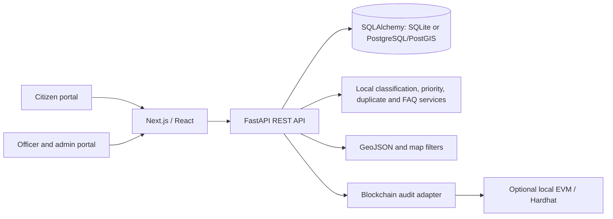

# JanSetu

**Connecting Citizens. Empowering Governance. Building Smarter Cities.**

JanSetu is a local-first smart governance prototype for citizen services, civic issue reporting, and transparent administration. It provides a connected React/Next.js portal and FastAPI API, with SQLite for zero-setup demos and PostgreSQL/PostGIS configuration for deployment.

## What works in this prototype

- Public landing, service, scheme, login, and registration pages, with citizen and administration workspaces.
- JWT authentication, hashed passwords, role checks, citizen complaint ownership, and seeded demo accounts.
- Complaint filing, attachments, categorization and priority suggestions, duplicate suggestions, department recommendation, status history, comments, feedback, and reopen workflow.
- SLA deadline calculations and an API-triggered escalation worker entry point.
- Curated demo scheme directory and transparent rule-based eligibility checks.
- Deterministic multilingual FAQ assistant with source labels; no LLM key required.
- GIS complaint feed and map interface, CSV reports, notifications, blockchain audit service interface, and a Solidity audit contract.
- Docker Compose for API, frontend, PostGIS, and local Hardhat node.

This is an educational demonstration, not an official government service. Seeded complaints, schemes, statistics, users, and locations are fictional. Demo SLAs are configurable and are not official service commitments. Scheme and service guidance must be checked against the linked authority before use.

## Architecture



## Run locally

Requirements: Python 3.11+, Node.js 20+, npm. Docker is optional.

1. Copy `.env.example` to `.env` and adjust values if needed.
2. Start API:

   ```powershell
   cd backend
   py -m venv .venv
   .\.venv\Scripts\Activate.ps1
   pip install -r requirements.txt
   uvicorn app.main:app --reload --port 8000
   ```

   Tables and fictional demo data are created on startup. API docs: http://localhost:8000/docs.

3. Start frontend in another terminal:

   ```powershell
   cd frontend
   npm install
   npm run dev
   ```

   Visit http://localhost:3000. Set `NEXT_PUBLIC_API_URL` if the API is hosted elsewhere.

### Demo accounts

All demo accounts use password `JanSetuDemo!2026`.

| Role | Email |
|---|---|
| Administrator | admin@jansetu.demo |
| Department manager | manager@jansetu.demo |
| Department officer | officer@jansetu.demo |
| Citizen | citizen@jansetu.demo |

Change demo passwords and the JWT secret before any shared or deployed use.

## Docker

```powershell
docker compose up --build
```

The compose configuration provides the frontend, FastAPI, PostGIS, and a local Hardhat node. The API defaults to SQLite for a zero-service local start; set `DATABASE_URL` to the PostGIS service URL to use it. Docker startup, contract deployment, and frontend production builds have not been verified in every host environment.

## AI, GIS, and audit limits

`backend/app/services/ai.py` is a transparent local rules and token-similarity baseline, not a trained model. It exposes confidence and rationale and is intended only to assist human triage. Image inspection records safe metadata and basic image characteristics; no pretrained vision weights are bundled. Voice can use browser speech recognition, with a text fallback. The assistant answers only from a small curated demo FAQ and identifies that source; it does not claim to be a government authority.

GIS data is returned as GeoJSON. PostGIS is optional and intended for spatial deployment queries. Blockchain writes are pending/unavailable unless a contract and signer are configured; database audit records are not represented as blockchain-verified. The Solidity contract stores only hashes and non-sensitive references.

## Security and deployment

Configure `SECRET_KEY`, `DATABASE_URL`, `CORS_ORIGINS`, and optional `BLOCKCHAIN_*` settings from the environment. Use HTTPS, secure cookie/session settings, managed secret storage, private object storage, backup/retention policies, and rate limiting at the production gateway. File uploads are size/type checked and stored locally under a private backend directory in development. PostgreSQL migrations are represented by SQLAlchemy metadata bootstrap in this prototype; Alembic migration history still needs to be generated before production rollout. Do not expose demo data or credentials in a public deployment.

## API overview

See [docs/api.md](docs/api.md), or interactive OpenAPI docs at `/docs`. Main groups: `/api/auth`, `/api/complaints`, `/api/ai`, `/api/departments`, `/api/admin`, `/api/schemes`, `/api/gis`, `/api/blockchain`, `/api/notifications`, and `/api/reports`.

## Tests

Backend tests are in `backend/tests`. Run `cd backend; pip install -r requirements.txt; pytest`. Frontend build/lint: `cd frontend; npm install; npm run build`.

## Future work

Production-ready email verification and reset flows, curated government source review, model training and evaluation, real object storage, scheduled task queue, complete Alembic history, richer accessibility/localization QA, browser E2E coverage, and verified contract deployment are future work. No production deployment has been performed.
